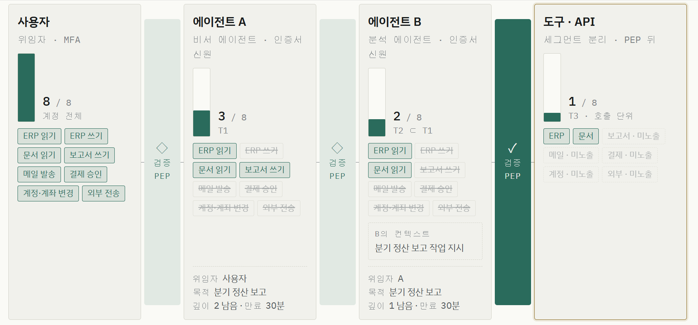
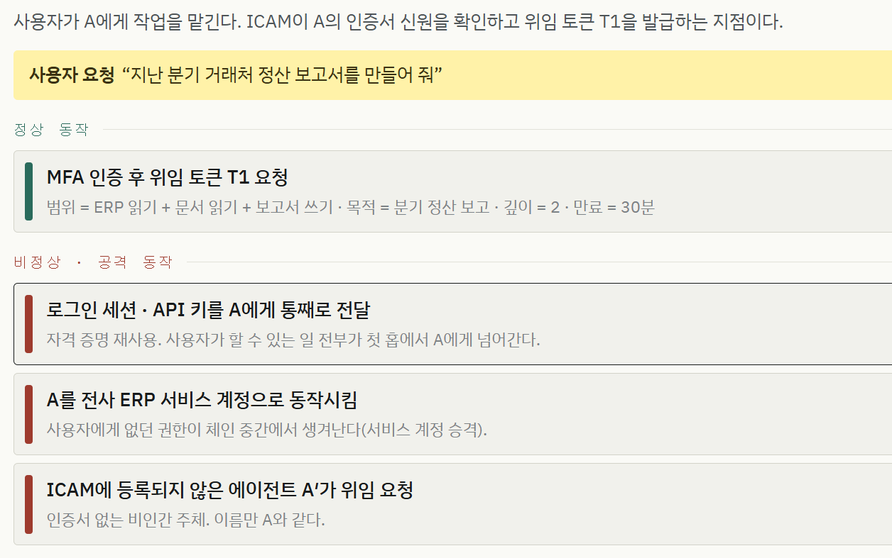

# 위임 체인 시뮬레이터 (Delegation Chain Simulator)

AI 에이전트 위임 체인에 제로 트러스트(ZTA)를 적용했을 때, 홉(hop)마다 권한이 어떻게 좁아지고 비정상 동작이 어디서 막히는지 직접 눌러 보며 확인하는 단일 HTML 시뮬레이터입니다.

**라이브 데모:** <https://aquawitch.github.io/delegation_chain_simulation/>

- 파일: `delegation-chain-sim.html` (의존성 없음, 브라우저에서 바로 열면 됩니다)
- `index.html`은 위 파일로 바로 넘겨주는 진입점입니다 (GitHub Pages용)
- 구조: **사용자 → 에이전트 A → 에이전트 B → 도구·API**, 각 구간 사이에 검증 지점(PEP)

## 핵심 개념: 홉마다 인가 권한의 축소

- **사용자**는 계정 전체 권한(8개)을 가집니다.
- **에이전트 A**는 위임 토큰 **T1**을 받습니다. 사용자 권한 중 목적에 필요한 부분집합(예: ERP 읽기 · 문서 읽기 · 보고서 쓰기)만 담깁니다.
- **에이전트 B**는 재위임 토큰 **T2 ⊂ T1**을 받습니다. A가 넘기지 않은 범위(보고서 쓰기)는 더 이상 내려가지 않습니다.
- **도구·API**는 호출 단위 권한만 보며, 토큰에 없는 세그먼트(메일 · 결제 · 계정 · 외부)는 아예 노출되지 않습니다.
- 각 토큰은 위임자 · 목적 · 남은 깊이 · 만료 시간을 함께 가지고 다닙니다.

## 사용법: 순차적으로 따라 누르는 시뮬레이션

1. 상단에서 **시나리오**와 **체인 구성**(`ZTA 적용` / `검증 없는 체인`)을 고릅니다.
2. 홉마다 **정상 동작**(초록)과 **비정상·공격 동작**(빨강) 버튼이 나타납니다. 하나씩 눌러 판정 결과를 확인합니다.
3. 판정은 `허용` / `거부` / `차단·체인 절단` / `정지선·사람 재승인` 중 하나로 표시되며, 어떤 검증 항목에서 걸렸는지 체크리스트로 보여 줍니다.
4. 마지막에 **S7 · 사후 조사**를 누르면 체인 식별자 하나로 전 구간 로그가 재구성됩니다.
5. 자동 재생 버튼으로 시나리오를 정해진 순서(S1~S7)대로 재생할 수도 있습니다.

같은 동작을 `검증 없는 체인` 모드로 바꾸면 세션·API 키가 그대로 넘어가 공격 동작이 전부 실행되는 모습을 대비해 볼 수 있습니다.

## 시나리오

| # | 요청 | 깊이 | 주요 확인 포인트 |
|---|---|---|---|
| ① | 분기 정산 보고서 작성 | 2 | 재위임 시 범위 축소, PDF 속 숨은 지시로 인한 결제 승인 시도 차단 |
| ② | 미수금 현황 확인 | 0 | 재위임 금지, 회신 메일로 오염된 뒤 독촉 메일 대량 발송 차단 |
| ③ | 정산 안내 메일 발송 | 1 | 범위 안 호출이라도 발송량·수신처가 패턴을 벗어나면 체인 절단 |
| ④ | 브라우저 에이전트 · 주문 조회 | 0 | 로그인 세션을 에이전트에 넘기지 않음, 읽기만 허용 |
| ⑤ | 송장 결제 승인 · 정지선 | 1 | 금액 상한 · 송장 한정 토큰, 비가역 행동 앞 사람 재승인 |

## 판정 규칙

시뮬레이션의 판정은 다음 항목을 그대로 옮긴 것입니다.

- **신원**: ICAM에 등록된 인증서 신원만 토큰을 받을 수 있습니다.
- **끊기지 않은 체인**: 세션·API 키의 통째 전달은 구조적으로 불가능합니다.
- **범위 ⊂ 상위 범위**: 하위 토큰은 상위 토큰의 부분집합만 가집니다. 권한은 홉을 거치며 넓어질 수 없습니다.
- **깊이와 만료**: 토큰에 명시된 최대 깊이를 넘는 재위임, 만료된 토큰은 거부됩니다.
- **목적 부합 · 이상행위 탐지**: 범위 안이라도 목적과 학습된 패턴을 벗어나면 해당 토큰과 하위 토큰을 즉시 무효화합니다.
- **세그먼트 분리**: 토큰에 없는 세그먼트는 PEP 뒤에서 아예 보이지 않으며, PEP 우회 경로는 열리지 않습니다.
- **정지선**: 결제 · 계정 변경 · 삭제 같은 비가역 행동은 사람 위임자의 재승인 없이 진행되지 않습니다.
